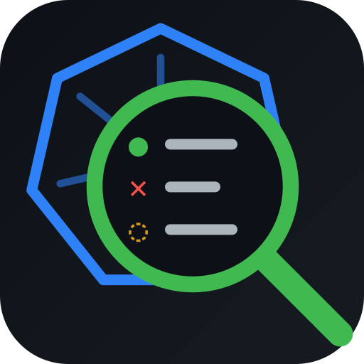
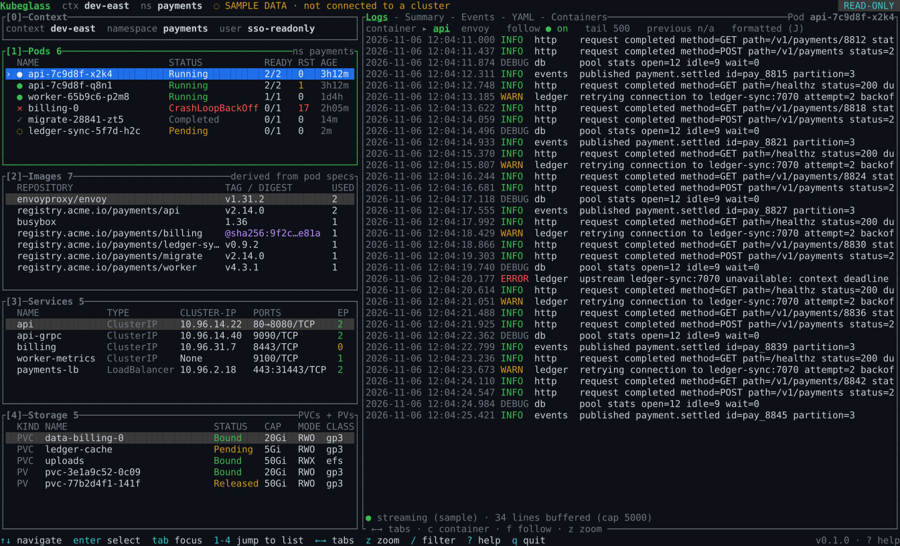

<p align="center"></p>

# Kubeglass (`kglass`)

A fast, **read-only** terminal viewer for Kubernetes clusters. Pick a pod, image, service or volume from the lists on the left, and the large viewer on the right shows its logs, details and related resources.

> **Status: beta (phase 4).** Connects to your real cluster, read-only. Uses the same kubeconfig, context and namespace that `kubectl` would.



*Rendered from `kglass --demo` with `cargo run --example screenshot`.*

## Features

- **Opens where kubectl points.** It honours `$KUBECONFIG` (a colon-separated list, merged), `current-context`, and the namespace set by `kubens`/`kubectl config set-context`. The flags `--kubeconfig`, `--context` and `-n` work like kubectl's.
- **Live lists of Pods, Images, Services and Storage**, refreshed every 10s (or with `r`):
  - Images are worked out from the pod specs.
  - Storage shows the namespace's claims and the volumes bound to them.
- **The viewer shows the selected resource:**
  - Pods open on **live logs**, with a container switcher, follow mode and a buffer capped at 5000 lines.
  - Every resource has Summary/Details, Events and YAML tabs.
  - Service details show endpoint health and which pods match the selector.
- **Logs built for debugging:**
  - Structured JSON logs (for example ECS/Spring) show as readable `time LEVEL logger message ✕ error` lines; `J` shows the raw JSON.
  - `/` in the log viewer shows only the matching lines.
  - `p` shows the previous container instance's logs, for crash loops.
- **Jump between related resources.** From a service to its pods, a claim to its volume or the pods mounting it, a pod to its services and claims, an image to the pods using it: `↑↓` then `Enter` in the viewer.
- **Local containers too.** `kglass --oci` shows the containers of your local engine in the same screen: logs, search, JSON formatting, inspect and jump-to-related all work. It uses the `docker` CLI by default; `--oci podman` or `--oci nerdctl` use those instead.
- **Switch without leaving the app.** `x` picks a context and `n` picks a namespace. The switch lasts for the session only; kglass never writes to your kubeconfig. `/` filters a list by name.
- **Honest about problems.** Each pane shows its own state: loading, `Forbidden (403)` with the exact permission needed, timeouts, or stale data after a failed refresh. One failure never blanks the rest. Expired credentials show `● Disconnected` in the header.
- **Strictly read-only.** kglass only ever lists, gets and follows logs. It never reads Secrets and never shows credentials.
- **Safe display.** Cluster text is sanitized, so escape sequences in names or logs can't control your terminal.
- **Accessible.** Full keyboard control, with an optional mouse (see [docs/keybindings.md](docs/keybindings.md)). Status is never shown by colour alone, and `--no-color` or `NO_COLOR=1` turns colours off.

## Install

Requires Rust 1.89 or newer.

```bash
cargo install --locked --path .
```

This puts `kglass` in `~/.cargo/bin`. `--locked` builds with the dependency versions tested in `Cargo.lock`.

## Usage

```bash
kglass                        # current context and namespace, like kubectl
kglass -n payments            # another namespace
kglass --context dev-west     # another context
kglass --demo                 # built-in sample data, no cluster needed
kglass --oci                  # local containers via the `docker` CLI
kglass --oci podman           # …or via podman (or nerdctl)
kglass --oci -n my_app        # only one compose project
```

```bash
kglass -A                     # every namespace; rows are shown as namespace/name
```

On large clusters `-A` lists everything every 10s, and one refresh can take several seconds, so prefer a single namespace when you can.

### Local containers (`--oci`)

kglass runs only read-only commands of the CLI you name: `ps`, `container inspect`, `volume ls`/`inspect`, `logs` and `version`. It never runs a shell, and names are always passed after `--`. The four panes become **Containers, Images, Ports** (published host ports) and **Volumes**. `n` picks a compose project. The YAML tab shows `inspect` output with bind-mount host paths, the create command and volume options removed. Environment variables are shown as-is, like `kubectl` shows them. Previous-container logs (`p`) are a Kubernetes feature and are not available here.

### Permissions

Read-only access is enough: `get`/`list` on pods, services, persistentvolumeclaims, endpointslices and events, plus `get` on `pods/log`. PersistentVolumes and the namespace list are optional. Copy-ready Role/ClusterRole YAML is in [docs/rbac.md](docs/rbac.md); a test keeps it in sync with the permission list the code declares.

### Troubleshooting

```bash
cargo run --example probe            # fetch once from your current kubeconfig and print counts
cargo run --example probe -- --frame # also render one screen
```

## Development

```bash
cargo fmt --check && cargo clippy --all-targets -- -D warnings && cargo test
```

The design and roadmap are in [docs/design.md](docs/design.md), and the phase 1 plan is in [docs/plan-phase1.md](docs/plan-phase1.md).

## Contributing & security

See [CONTRIBUTING.md](CONTRIBUTING.md). Please report vulnerabilities privately, as described in [SECURITY.md](SECURITY.md).

## License

Licensed under either the [Apache License 2.0](LICENSE-APACHE) or the [MIT license](LICENSE-MIT), at your option.
